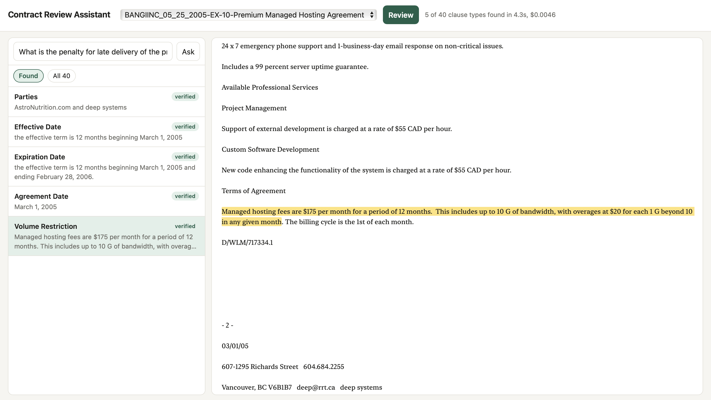
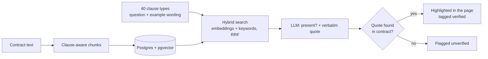

# Contract Review Assistant

**Live demo: https://contract-review-aql7.onrender.com** (free hosting: the first load after a quiet spell can take about
30 seconds to wake up)



Pick a commercial contract and the app checks it for 40 clause types (governing law, termination, exclusivity, liability
caps and so on). For each clause it finds, it shows the exact words from the contract, highlighted in place, and marks the
quote "verified" only if those words really exist in the contract text. There is also a question box that answers from the
contract and points to its sources.

Built and scored on [CUAD](https://github.com/TheAtticusProject/cuad): 510 real contracts, 13,823 spans marked by legal
experts (CC BY 4.0). Stack: OpenAI (embeddings + gpt-4o-mini), LangChain, LangGraph, Postgres + pgvector, FastAPI, Docker.

## Results at a glance

Scored against the experts' labels, on 100 contracts that were never used while tuning the prompt:

| What | Result |
|------|--------|
| Detecting which clauses are present (precision / recall / F1) | 77.8% / 86.2% / **81.8%** |
| Same, averaged over clause types (so rare clauses count equally) | 72.0% macro F1 |
| Quote found in the contract | 98.5% (94.4% word for word) |
| Cost to review one contract (40 checks) | about $0.01 |
| Time to review one contract | about 6 seconds (results are then saved) |

Finding the right passage (retrieval, clause_hit@5): 19.9% random, 68.0% with clause-aware chunks, and about 10 points
higher with query expansion plus hybrid search (table in Phase 2). Precision is a lower bound: CUAD's experts label
narrowly, so some "false positives" are real clauses nobody marked.

## How it works



Details of each stage, with the numbers that justified it, are in the phases below.

## Phase 1: ingest, clause-aware chunking, baseline retrieval, scored against expert labels

```bash
python -m venv .venv && source .venv/bin/activate
pip install -r requirements.txt
cp .env.example .env                      # put your OPENAI_API_KEY in .env

docker compose up -d                      # Postgres + pgvector, schema from sql/init.sql
python scripts/prepare_cuad.py            # downloads CUAD (18 MB) into data/cuad/
python -m app.ingest --chunker both --limit 5     # smoke test
python -m app.ingest --chunker both               # all 510 contracts, both chunkers (about 60k chunks)
```

Embedding cost: about 7 million tokens per chunker with `text-embedding-3-small`, well under $1 in total.
Re-running resumes: finished contracts are skipped.

### Measure it

```bash
python -m evals.run_eval --name p1_random --chunker clause --random      # chance baseline
python -m evals.run_eval --name p1_fixed  --chunker fixed  --k 5         # fixed 1000-char chunks
python -m evals.run_eval --name p1_clause --chunker clause --k 5         # clause-aware chunks
```

These make no LLM calls (40 query embeddings in total). For each (contract, clause type) the experts marked, we search
that contract with the clause-type question and check whether the top-k chunks cover the marked text.

| Metric | Meaning |
|--------|---------|
| clause_hit@k | at least one top-k chunk covers a marked span |
| span_recall@k | share of individual marked spans covered |
| mrr | reciprocal rank of the first covering chunk |
| macro_clause_hit | average over the 40 clause types, so rare clauses count as much as common ones |

A chunk covers a span if it contains at least half of it or at least 100 characters of it.

Already measured (no embeddings needed): an expert-marked clause lies fully inside a single chunk for 91.0% of spans
with fixed chunks (LangChain's RecursiveCharacterTextSplitter) and 96.0% with clause-aware chunks.

### Ask a question

```bash
uvicorn app.main:app --reload                       # docs at http://localhost:8000/docs
curl -s localhost:8000/contracts | head
curl -s localhost:8000/ask -H 'content-type: application/json' \
  -d '{"doc_name": "<a name from /contracts>", "question": "What law governs this agreement?"}'
```

## Phase 2: fix the weak clause types

Phase 1 baseline (clause_hit@5): random 19.9%, fixed chunks 67.6%, clause-aware chunks 68.0%. The weakest clause types were
Parties 23%, Volume Restriction 28%, Covenant Not To Sue 39%, Exclusivity 39% and the dates 43-45%. The search question is
generic ("Exclusivity: ...") but contracts use specific legal wording, and parties and dates sit in the preamble among
many similar passages. Each fix below is a switch, so every run adds one row to the table.

```bash
pip install -r requirements-rerank.txt                 # only for --rerank bge
python -m scripts.make_clause_queries                  # 40 cheap LLM calls -> data/cuad/clause_examples.json

python -m evals.run_eval --name p2a_hybrid  --chunker clause --hybrid
python -m evals.run_eval --name p2b_expand  --chunker clause --expand
python -m evals.run_eval --name p2c_both    --chunker clause --expand --hybrid
python -m evals.run_eval --name p2d_rerank  --chunker clause --expand --hybrid --rerank bge
```

| Run | Change | clause_hit@5 | span_recall@5 | mrr | macro_clause_hit |
|-----|--------|--------------|---------------|-----|------------------|
| p1_random | random chunks | 19.9 | 15.0 | 0.096 | 18.3 |
| p1_fixed | fixed chunks | 67.6 | 49.4 | 0.510 | 69.2 |
| p1_clause | clause-aware chunks | 68.0 | 52.4 | 0.511 | 69.6 |
| p2a_hybrid | + keyword search (RRF) | | | | |
| p2b_expand | + example clause wording as the query | | | | |
| p2c_both | + both | | | | |

Run `python -m evals.results_table` to print these rows from your own summary files. A cross-encoder reranker
(BAAI/bge-reranker-base) was also tried on a 20-contract subset: it scored worse than hybrid + expand and was slow, so it
was dropped (`--rerank bge` is still available).

- `--expand`: the LLM sees only the clause name and CUAD's one-line description (never a contract or a label) and writes an
  example of typical wording, which is used as the search query.
- `--hybrid`: Postgres full-text keyword search over the rarer words of the query, merged with embedding search by
  Reciprocal Rank Fusion. It is full-text ranking, not true BM25.
- `--rerank bge`: a cross-encoder (BAAI/bge-reranker-base, runs locally) re-orders the top 20 candidates.

Parties and the dates are probably better solved by extraction (Phase 3), which reads the opening of the contract directly,
than by retrieval. Check the per-clause numbers in the summary files before deciding.

## Phase 3: structured extraction, scored against the experts

Retrieval finds passages. Phase 3 turns them into answers: for each (contract, clause type) the LLM reads the best
passages and returns JSON, `{"present": true/false, "quote": "<verbatim text>"}`. The quote must be copied word for word,
so every answer is checked against the contract text. A quote that is not in the contract is counted as a hallucination.
Parties and the two date clauses also get the opening of the contract as context, because retrieval is weakest there.

```bash
python -m evals.run_extraction --name p3_smoke --limit 5          # a few contracts first (cents)
python -m evals.run_extraction --name p3_dev   --limit 20         # tuning set: read its failures, improve the prompt
python -m evals.run_extraction --name p3_100   --skip 20 --limit 100   # held-out: contracts never used for tuning (about $1)
python -m evals.run_extraction --name p3_full                     # all 510 contracts, 20,400 clause checks
python -m evals.run_extraction --name p3_nohead --skip 20 --limit 100 --no-head   # ablation: without the contract opening
```

Then read the failures yourself (numbers alone hide whether the system or the labels are wrong):

```bash
python -m evals.analyze_extraction p3_100 --show 6
```

It is resumable: if it stops (laptop sleeps, network drops), run the same command and it continues.

| Metric | Meaning |
|--------|---------|
| precision / recall / F1 | did it correctly say "present" or "not present"? Micro over all checks, and macro over clause types |
| span_match_rate | of the clauses it detected correctly, how often its quote overlaps the experts' marked text |
| grounded_rate | how often the quote is found in the contract: word for word, or at least 90% of it (page headers or a skipped aside break exact matching) |
| exact_quote_rate | how often the quote is found word for word |
| cost per contract | input and output tokens at the prices in `evals/run_extraction.py` (check current pricing) |

The 40 clause checks per contract include the many clauses a contract does NOT have, so precision matters: a system
that claims a clause exists when it does not is as wrong as one that misses it.

### Results

Prompt tuned on the first 20 contracts only. Scored on the next 100, which were never looked at while tuning.

| Run | Contracts | Precision | Recall | F1 | Macro F1 | Span match | Quote found | $ / contract |
|-----|-----------|-----------|--------|----|----------|------------|-------------|--------------|
| v2 prompt (tuning set) | 20 | 69.7 | 83.3 | 75.9 | 66.7 | 85.0 | 95.4 | 0.0101 |
| v3 prompt (tuning set) | 20 | 76.3 | 81.3 | 78.7 | 66.6 | 90.0 | 99.3 | 0.0101 |
| v4 prompt (tuning set) | 20 | 73.1 | 82.5 | 77.5 | 67.8 | 88.7 | 99.0 | 0.0102 |
| **v4 prompt, held-out** | **100** | **77.8** | **86.2** | **81.8** | **72.0** | **86.5** | **98.5** | **0.0095** |

What changed between versions:
- v2: stricter prompt (a related clause type does not count, ignore blank form fields).
- v3: quote matching ignores spacing and trailing punctuation, accepts a quote when at least 90% of it is found
  (PDF page headers and skipped "(as defined in ...)" asides broke exact matching), plus a one-line "does not count" note
  for eight easily confused clause types.
- v4: removed two of those notes (Affiliate License): recall on those fell from 100% to 0%.

Known limits:
- CUAD experts label narrowly and miss some clauses, so some "false positives" are real clauses nobody marked.
  Precision is therefore a lower bound.
- Weakest clause types on held-out: Volume Restriction (F1 30), Third Party Beneficiary, Uncapped Liability (F1 47),
  and the two Affiliate License types (precision under 35%).
- 100 contracts and 4,000 checks. Several clause types have only a handful of labelled examples.

## Phase 5: one-page app, Docker

Pick a contract, press Review, and all 40 clause types are checked. Found clauses are listed with a "verified" tag when the
quote exists in the contract word for word, and clicking one highlights those exact words in the contract text. There is
also a question box that answers from the contract and links each citation to its passage.

```bash
python -m scripts.export_clauses        # once: writes app/clauses.json (commit it, the deployed app needs it)
docker compose up --build               # database + app
```

Open http://localhost:8000. The first review of a contract takes about 10 seconds and about one cent; the result is saved
in Postgres (table `reviews`), so opening it again is instant and free. Only contracts you have ingested can be reviewed,
so a public demo cannot be made to spend more than ingesting-everything-once would (about $5 for all 510).

Ingest from your Mac as before (`python -m app.ingest --chunker clause --limit 120`, with the database running), or
inside Docker: `docker compose run --rm api python -m app.ingest --chunker clause --limit 120`.

API (docs at /docs): `GET /contracts`, `GET /contract?doc_name=...` (full text), `POST /review` (all 40 clauses with
character ranges), `POST /ask` (question answering with citations).

### Put it online

Any host that runs a Dockerfile works. This is the setup with Render (the app) and Neon (Postgres with pgvector); both
have free tiers, check their current limits.

1. **Database.** Create a Neon project and copy its connection string (it ends in `?sslmode=require`).
2. **Load it from your computer** (the environment variable overrides `.env` for these commands only):
   ```bash
   export DATABASE_URL="postgresql://...neon.tech/neondb?sslmode=require"
   python -m scripts.init_db
   python -m app.ingest --chunker clause --limit 120    # 120 contracts is about 100 MB, inside Neon's free storage
   ```
3. **App.** On Render create a Web Service from this GitHub repo (it detects the Dockerfile). Add two environment
   variables: `DATABASE_URL` (the Neon string) and `OPENAI_API_KEY`. Never commit either.
4. **Spending cap.** Set a monthly limit in the OpenAI dashboard. The question box is limited to 15 questions per visitor
   per hour and 300 per day (`app/ratelimit.py`); reviews are cached and only ingested contracts can be reviewed.

`app/clauses.json` must be committed, because the deployed app has no CUAD download.

## Tests

Unit tests cover the logic that decides whether an answer can be trusted: Reciprocal Rank Fusion, the verbatim and fuzzy
quote checks, parsing of the model's JSON, both chunkers, and the clause list. They need no database and no API key.

```bash
pip install -r requirements.txt -r requirements-dev.txt
python -m pytest -q
```

GitHub Actions runs them on every push and pull request.

## Limitations and what I would improve next

- **Citation labels in the question box** show the heading where a retrieved chunk begins, not the sentence that supports
  the answer. Next: check the answer's quoted text against the contract and link to that passage, then measure citation
  accuracy (Phase 4).
- **Some quotes point at a cross-reference** instead of the clause itself (for example "terminated under Section 9.2" rather
  than Section 9.2). About 1 in 7 correct detections overlaps no expert text.
- **Weak clause types** on held-out contracts: Volume Restriction (F1 30), Uncapped Liability (F1 47), Third Party
  Beneficiary, and the two Affiliate License types (precision under 35%).
- **Blank or redacted fields** (for example an agreement date left empty in the source) are quoted faithfully but give no
  usable value. "Verified" means the words exist in the contract, not that the answer is complete.
- **Evaluation size:** 100 held-out contracts; several clause types have only a handful of labelled examples.
- **Demo limits:** 120 contracts are loaded, and the question box allows 15 questions per visitor per hour and 300 per day.

## Roadmap

| Phase | What | Status |
|-------|------|--------|
| 1 | Ingest, two chunkers, dense retrieval, eval vs expert labels | done |
| 2 | Query expansion, hybrid search (dense + keyword), reranker tested | done |
| 3 | LLM extraction into JSON with verbatim quotes, checked against the contract | done |
| 4 | Answer quality: citation accuracy, "not addressed" handling | not started |
| 5 | One-page UI, Docker, deployed demo | done |

CUAD is licensed CC BY 4.0: credit Hendrycks et al., "CUAD: An Expert-Annotated NLP Dataset for Legal Contract Review" (NeurIPS 2021).